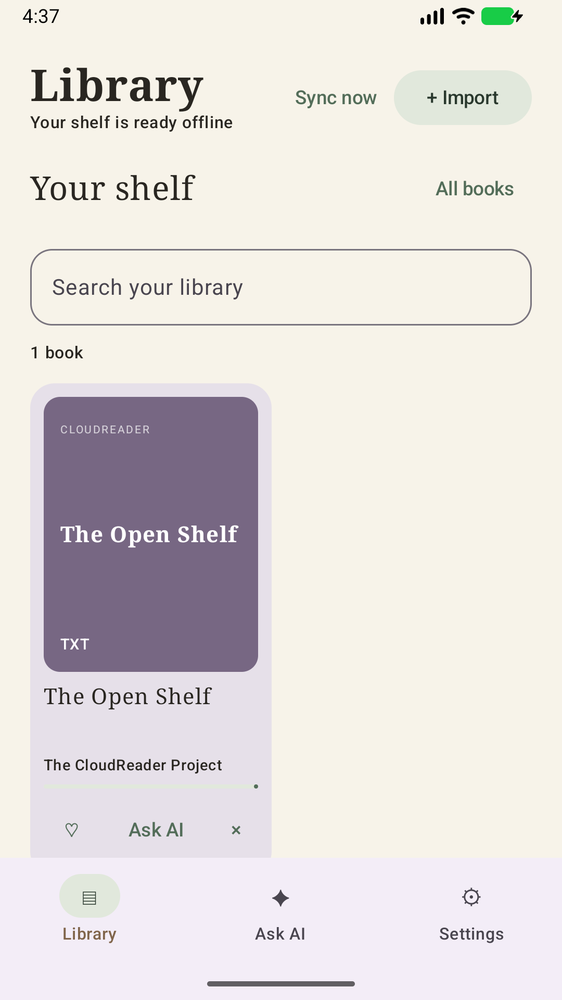
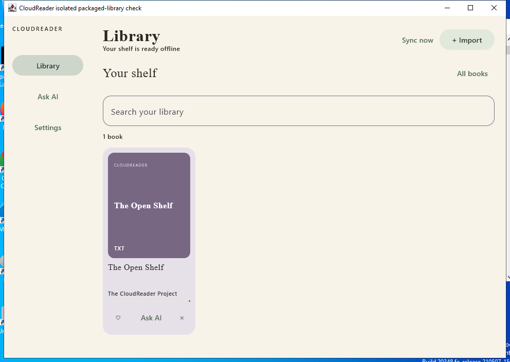

# CloudReader

CloudReader is an **open-source, offline-first book library and reader for iOS, macOS, Android, Windows and Linux**. Import DRM-free books while keeping the original files untouched. The library works offline, with no CloudReader account or hosted backend.

Sync directly with storage destinations you choose. Your books, reading progress, favorites, deletions, and saved AI conversations can move between devices; provider credentials stay on each device.

## Features

- Read DRM-free books with native apps for each platform.
- Import from the Files app, Android document picker, or supported share flows.
- Choose multiple sync destinations, including Google Drive, Dropbox, pCloud, WebDAV, SFTP, and platform file providers. Availability varies by platform.
- Ask questions with a compatible remote AI service, or use Apple's on-device model on supported Apple devices. Book text is included only when you choose to share it with a question.
- Keep credentials out of sync data. Android uses Keystore; desktop uses Windows Credential Manager or Linux Secret Service. If a desktop vault is unavailable, credentials are session-only unless the user explicitly opts into the disclosed plaintext fallback.

## Platform support

| Platform | Minimum version | Reading support |
| --- | --- | --- |
| iOS and iPadOS | iOS 26 | EPUB, PDF, TXT, FB2, and CBZ readers. Additional formats can be imported; see the [iOS guide](docs/IOS_FIRST.md) for current reader availability. |
| macOS | macOS 15 | EPUB, FB2, MOBI/AZW3, TXT, PDF, and CBZ/CBR readers. |
| Android | Android 12 (API 31) | EPUB, PDF, TXT, FB2, and CBZ readers; other formats remain storage-only. |
| Windows | Windows 10/11 x64 | Shared Kotlin/Compose client; TXT, PDF, EPUB, FB2 and CBZ reader hosts. |
| Linux | Debian 12 x64 baseline | Same shared desktop client; other distributions can build from source. |

The iOS and macOS apps share their Swift data model and sync implementation. Android is a native Kotlin and Jetpack Compose app that follows the same portable schema. Windows and Linux share a Kotlin/JVM desktop client while keeping OS integrations separate; there is no web app.

## Download the 1.2.0 preview

Android, Windows and Linux are built together from one version and source revision.
This **October 31, 2026 prerelease** is a convergence preview, not a production
release or a claim of complete iOS feature/visual parity.

| Download | Requirements | Distribution status |
| --- | --- | --- |
| [All three apps + UI/test evidence](https://github.com/HaiGe120/CloudReader/releases/download/v1.2.0-unified-preview/CloudReader-1.2.0-all-platforms-preview.zip) | Choose your OS package | Includes notices and the progress report |
| [Android APK](https://github.com/HaiGe120/CloudReader/releases/download/v1.2.0-unified-preview/CloudReader-1.2.0-android-debug.apk) | Android 12+ | CI debug-signed; not a verified update to existing installations |
| [Windows MSI](https://github.com/HaiGe120/CloudReader/releases/download/v1.2.0-unified-preview/CloudReader-1.2.0-windows.msi) | Windows x64 | Unsigned preview; bundled Java runtime |
| [Linux DEB](https://github.com/HaiGe120/CloudReader/releases/download/v1.2.0-unified-preview/CloudReader-1.2.0-linux.deb) | Debian 12 amd64 baseline | Bundled Java runtime; native dependencies required |

See the [release notes](docs/releases/1.2.0-unified-preview.md),
[SHA-256 checksums](https://github.com/HaiGe120/CloudReader/releases/download/v1.2.0-unified-preview/SHA256SUMS)
and [third-party notices](THIRD_PARTY_NOTICES.md). Matching Java/OpenJFX sources
and a license companion accompany the release. Apple builds have separate
versions/channels; see [all releases](https://github.com/HaiGe120/CloudReader/releases).

**Keep your existing library.** If the Android signing certificate differs from
your installed app, do not uninstall it or clear its data to force this APK to
install. A safe in-place update requires the original matching signing key.

The preview passed 121 Android JVM tests, 29 local isolated-emulator tests,
15 tests each on Windows and Debian, 20 shared-core tests and four collector
tests. Windows/Debian bundled launchers also rendered PDF, turned WebKit pages
and displayed the real shared library UI.

**Still open:** production signing, installed-OS updates/accessibility, physical
Android behavior, live OAuth/AI/cross-platform sync, desktop export/share and full
iOS parity. Schema-v1 concurrent writers can overwrite unseen changes; sync
devices sequentially. See the [feature matrix and verification limits](docs/engineering/evidence/UNIFIED-KOTLIN-01.md).

### Actual preview UI

Running apps with the included sample book—not mockups:

<p>
  
  
</p>

## Build from source

### iOS and iPadOS

Requirements: Xcode 26 or later, the iOS 26 SDK, and [XcodeGen](https://github.com/yonaskolb/XcodeGen).

```sh
cd Apps/iOS
xcodegen generate --spec CloudReader.xcodegen.yml
open CloudReader.xcodeproj
```

Select the **CloudReader** scheme and an iOS 26 or later simulator, then run. For a physical device, configure your development team in Xcode. See the [iOS setup guide](docs/IOS_FIRST.md) for signing, imports, provider setup, and AI configuration.

### macOS

Requirements: Xcode 26 or later, the macOS 15 SDK, and XcodeGen.

```sh
cd Apps/macOS
xcodegen generate --spec CloudReader.xcodegen.yml
open CloudReader.xcodeproj
```

Select the **CloudReader** scheme and run it on **My Mac**.

### Android

Requirements: JDK 17 and the Android SDK. From the repository root:

```sh
cd Apps/Android
./gradlew assembleDebug
```

The debug APK is created at `Apps/Android/app/build/outputs/apk/debug/app-debug.apk`. See the [Android guide](Apps/Android/README.md) for checks, emulator setup, and Google Drive registration.

### Windows and Linux

Requirements: JDK 17; WiX Toolset 3 and Git Bash on Windows, or Debian packaging
tools and native GUI libraries on Linux. Build each installer on its own OS:

```sh
bash scripts/build-app.sh windows   # on Windows
bash scripts/build-app.sh linux     # on Debian 12
```

Packages and manifests are written to `Build/Coordinated/<platform>/`. The shared
Android/desktop application uses the current iOS feature set as its reference.
Use the **Android, Windows and Linux** workflow for coordinated
same-version APK/MSI/DEB output. See [desktop setup and verification limits](Apps/Desktop/README.md)
and [the convergence task](docs/engineering/UNIFIED_KOTLIN.md).

No provider account or AI key is required for offline development. See the
[contribution guide](CONTRIBUTING.md) for focused changes and safe tests.

## Project documentation

- [Product and platform specification](docs/PROJECT_SPEC.md)
- [Portable sync contract](Contracts/v1/README.md)
- [iOS setup](docs/IOS_FIRST.md)
- [Android setup](Apps/Android/README.md)
- [Engineering architecture and implementation plan](docs/engineering/README.md)
- [Changelog](CHANGELOG.md) and [release procedure](docs/RELEASING.md)
- [Contributing](CONTRIBUTING.md), [bug reports / feature requests](https://github.com/HaiGe120/CloudReader/issues/new/choose), and [private security reporting](SECURITY.md)

## Repository layout

```text
Apps/
  iOS/       Native SwiftUI app
  macOS/     Native SwiftUI app
  Shared/    Shared Apple models, sync, AI, and App Intent
  Android/   Native Kotlin and Compose app
  Desktop/   Shared Kotlin/JVM desktop app for Windows and Linux
  Linux/     Linux packaging and native integration
  Windows/   Windows packaging and native integration
docs/        Product and platform documentation
Packages/
  CloudReaderKit/      Swift package and tests
  CloudReaderKotlin/   Portable Kotlin core and contract tests
  CloudReaderUI/       Shared Android/desktop Compose UI
```

The included sample book, **The Open Shelf**, is original text released under CC0 1.0.

## License

CloudReader's original source is [MIT licensed](LICENSE). Dependencies retain
their own licenses; the MIT grant does not relicense third-party libraries,
runtimes, fonts or platform SDKs. See [third-party notices](THIRD_PARTY_NOTICES.md).
