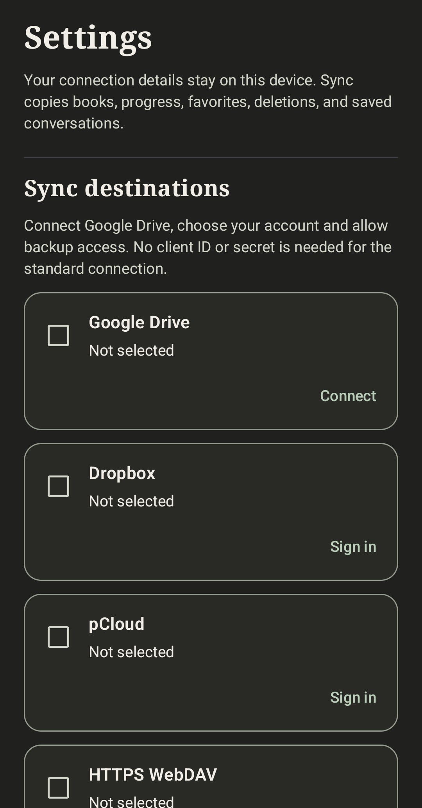
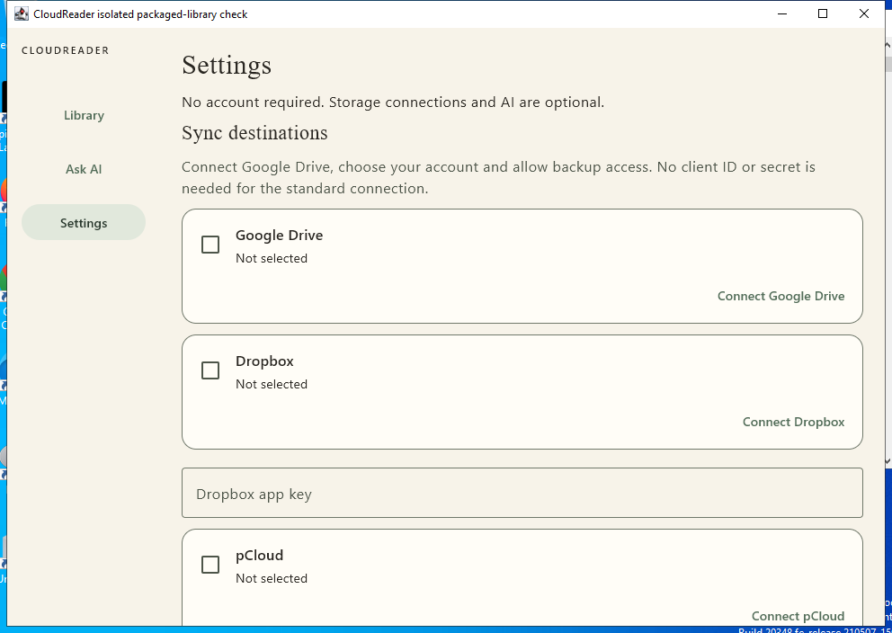

# CloudReader

CloudReader is an **open-source, offline-first book library and reader for iOS, macOS, Android, Windows and Linux**. Import DRM-free books while keeping the original files untouched. The library works offline, with no CloudReader account or hosted backend.

[iPhone and iPad on the App Store](https://apps.apple.com/app/id6825674209) · [Android 1.2.2 preview APK](https://github.com/HaiGe120/CloudReader/releases/download/v1.2.2-android-preview/CloudReader-1.2.2-android-debug.apk) · [Windows and Linux downloads](#downloads)

## Features

- **Bring your own books.** Import DRM-free files through Files, the Android document picker or a supported share action. Read offline and pick up where you left off.
- **Sync through your own storage.** Move books, progress, favorites and saved AI conversations between devices. Choose from Google Drive, Dropbox, pCloud, WebDAV, SFTP and platform file providers, depending on your platform.
- **Ask questions as you read.** On iOS, macOS and Android, resume a book’s conversation or start a fresh one. Include nearby text when you want help with a passage, or turn book context off before sending. Send from the keyboard, browse your provider’s models and optionally enable web search with a compatible provider.
- **Translate a word in place.** Select an English word and choose a target language on iPhone, iPad, Mac or Android. Android uses translation languages available on the device.

### New in the Android 1.2.2 preview

Follow the system appearance or choose Light or Dark. The reader opens with its toolbar tucked away. Tap the compact progress indicator to bring the controls back.

On a supported device with Gemini Nano already installed, Ask AI can answer offline. In Settings, you can explicitly save or restore your AI profile through Android Credential Manager. The saved API key is tied to the provider’s address. [Android release notes](https://github.com/HaiGe120/CloudReader/releases/tag/v1.2.2-android-preview)

The November 26 **iOS source preview** also adds compact progress, appearance controls and optional iCloud Keychain sharing for the AI profile. On supported Apple devices, the on-device model can answer offline and the configured provider takes over when connectivity returns. [iOS source preview](https://github.com/HaiGe120/CloudReader/releases/tag/ios-preview-2026-11-26)

## Platform support

| Platform | Minimum version | Reading support |
| --- | --- | --- |
| iOS and iPadOS | iOS 26 | EPUB, PDF, TXT, FB2, and CBZ readers. Additional formats can be imported; see the [iOS guide](docs/IOS_FIRST.md) for current reader availability. |
| macOS | macOS 15 | EPUB, FB2, MOBI/AZW3, TXT, PDF, and CBZ/CBR readers. |
| Android | Android 12 (API 31) | EPUB, PDF, TXT, FB2, and CBZ readers; other formats remain storage-only. |
| Windows | Windows 10/11 x64 | Shared Kotlin/Compose client; TXT, PDF, EPUB, FB2 and CBZ reader hosts. |
| Linux | Debian 12 x64 baseline | Same shared desktop client; other distributions can build from source. |

The iOS and macOS apps share their Swift data model and sync implementation. Android is a native Kotlin and Jetpack Compose app that follows the same portable schema. Windows and Linux share a Kotlin/JVM desktop client while keeping OS integrations separate; there is no web app.

## Downloads

| Platform | Download | Requirements |
| --- | --- | --- |
| iPhone and iPad | [App Store](https://apps.apple.com/app/id6825674209) | iOS or iPadOS 26+ |
| Android | [1.2.2 preview APK](https://github.com/HaiGe120/CloudReader/releases/download/v1.2.2-android-preview/CloudReader-1.2.2-android-debug.apk) | Android 12+ |
| Windows | [1.2.1 preview MSI](https://github.com/HaiGe120/CloudReader/releases/download/v1.2.1-google-connect-preview/CloudReader-1.2.1-windows.msi) | Windows x64, unsigned installer |
| Linux | [1.2.1 preview DEB](https://github.com/HaiGe120/CloudReader/releases/download/v1.2.1-google-connect-preview/CloudReader-1.2.1-linux.deb) | Debian 12 amd64 baseline |

**Android upgrades.** The 1.2.2 APK uses the same debug signing certificate as 1.2.1. The public 1.2.0 APK used a different key and cannot update in place. If you use 1.2.0, keep your installation and its library data.

Release pages include checksums and notices. The November 1 Windows and Linux preview includes the bundled Java runtime and standard Google connection. [Android 1.2.2 release](https://github.com/HaiGe120/CloudReader/releases/tag/v1.2.2-android-preview) · [Windows and Linux 1.2.1 release](https://github.com/HaiGe120/CloudReader/releases/tag/v1.2.1-google-connect-preview) · [All releases](https://github.com/HaiGe120/CloudReader/releases)

When several devices share storage, sync them one at a time. Concurrent writers using schema v1 can overwrite changes they have yet to see. [Sync contract](Contracts/v1/README.md)

### Settings on Android and Windows

<p>
  
  
</p>

## Build from source

### iOS and iPadOS

Requirements: Xcode 26 or later, the iOS 26 SDK, and [XcodeGen](https://github.com/yonaskolb/XcodeGen).

```sh
cd Apps/iOS
xcodegen generate --spec CloudReader.xcodegen.yml
open CloudReader.xcodeproj
```

Select the **CloudReader** scheme and an iOS 26 or later simulator, then run. For a physical device, configure your development team in Xcode. See the [iOS setup guide](docs/IOS_FIRST.md) for signing, imports, provider setup, and AI configuration.

### macOS

Requirements: Xcode 26 or later, the macOS 15 SDK, and XcodeGen.

```sh
cd Apps/macOS
xcodegen generate --spec CloudReader.xcodegen.yml
open CloudReader.xcodeproj
```

Select the **CloudReader** scheme and run it on **My Mac**.

### Android

Requirements: JDK 17 and the Android SDK. From the repository root:

```sh
cd Apps/Android
./gradlew assembleDebug
```

The debug APK is created at `Apps/Android/app/build/outputs/apk/debug/app-debug.apk`. See the [Android guide](Apps/Android/README.md) for checks, emulator setup, and Google Drive registration.

### Windows and Linux

Requirements: JDK 17; WiX Toolset 3 and Git Bash on Windows, or Debian packaging
tools and native GUI libraries on Linux. Build each installer on its own OS:

```sh
bash scripts/build-app.sh windows   # on Windows
bash scripts/build-app.sh linux     # on Debian 12
```

Packages and manifests are written to `Build/Coordinated/<platform>/`. The shared
Android/desktop application uses the current iOS feature set as its reference.
Use the **Android, Windows and Linux** workflow for coordinated
same-version APK/MSI/DEB output. See [desktop setup and verification limits](Apps/Desktop/README.md)
and [the convergence task](docs/engineering/UNIFIED_KOTLIN.md).

No provider account or AI key is required for offline development. See the
[contribution guide](CONTRIBUTING.md) for focused changes and safe tests.

## Project documentation

- [Product and platform specification](docs/PROJECT_SPEC.md)
- [Portable sync contract](Contracts/v1/README.md)
- [iOS setup](docs/IOS_FIRST.md)
- [Android setup](Apps/Android/README.md)
- [Google Drive connection and maintainer setup](docs/GOOGLE_DRIVE_SETUP.md) — standard connection, optional Advanced settings and current limits
- [Engineering architecture and implementation plan](docs/engineering/README.md)
- [Changelog](CHANGELOG.md) and [release procedure](docs/RELEASING.md)
- [Contributing](CONTRIBUTING.md), [bug reports / feature requests](https://github.com/HaiGe120/CloudReader/issues/new/choose), and [private security reporting](SECURITY.md)

## Repository layout

```text
Apps/
  iOS/       Native SwiftUI app
  macOS/     Native SwiftUI app
  Shared/    Shared Apple models, sync, AI, and App Intent
  Android/   Native Kotlin and Compose app
  Desktop/   Shared Kotlin/JVM desktop app for Windows and Linux
  Linux/     Linux packaging and native integration
  Windows/   Windows packaging and native integration
docs/        Product and platform documentation
Packages/
  CloudReaderKit/      Swift package and tests
  CloudReaderKotlin/   Portable Kotlin core and contract tests
  CloudReaderUI/       Shared Android/desktop Compose UI
```

The included sample book, **The Open Shelf**, is original text released under CC0 1.0.

## License

CloudReader's original source is [MIT licensed](LICENSE). Dependencies retain
their own licenses; the MIT grant does not relicense third-party libraries,
runtimes, fonts or platform SDKs. See [third-party notices](THIRD_PARTY_NOTICES.md).
