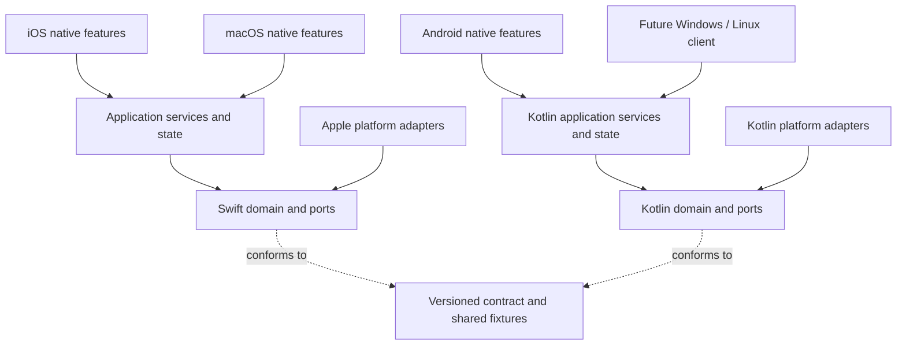

# CloudReader target architecture

Design date: 2026-10-20. Status: proposed implementation direction, grounded in the current working tree. See [current state](CURRENT_STATE.md) for existing behavior and [tasks](IMPLEMENTATION_PLAN.md) for the migration sequence.

## Product and platform decisions

CloudReader remains an offline-first, personal book library. Books and reading remain usable without network access, an AI account, or a CloudReader server. Import copies the original. User-selected providers synchronize book bytes and portable records; credentials stay on each device.

| Platform | Implementation decision | Near-term priority |
| --- | --- | --- |
| iOS / iPadOS | Retain SwiftUI, UIKit/WebKit bridges, PDFKit, current EPUB engine | Reference behavior, reliable import/reading, shared services extraction |
| macOS | Retain SwiftUI, AppKit/WebKit bridges, PDFKit | Use the same Apple services and iOS visual language; add desktop interaction conventions |
| Android | Retain Kotlin/Compose, Room, DataStore, Readium, AndroidX PDF | Persistence/lifecycle safety, feature parity, tested portable contract |
| Windows | Proposed Kotlin/JVM Compose Desktop client shared with Linux | Gated feasibility slice after current clients stabilize |
| Linux | Same proposed desktop client, OS-specific integration adapters | Separate Linux build/install/accessibility verification |

The Windows/Linux choice is a recommendation to validate in D01, not a shipped dependency or a requirement to rewrite Android. It limits the number of implementation languages and can reuse a pure Kotlin contract/merge library. Android reader libraries and Room entities are not automatically portable. D01 must prove PDF/EPUB engines, credentials, accessibility, and packaging before this choice is ratified. No desktop framework is added during the Apple/Android cleanup.

The desktop packaging mechanism can produce self-contained Windows and Linux installers; its standard packaging tasks require the corresponding OS. Plan separate Windows/Linux runners. [Official packaging documentation](https://kotlinlang.org/docs/multiplatform/compose-native-distribution.html).

## Dependency direction



Composition roots construct adapters and inject them into services. Views call controllers/actions; controllers call services; services use interfaces. The Apple application container must be constructible independently of a SwiftUI scene so an App Intent with `openAppWhenRun = false` can execute without opening a window. Views and intents resolve the same repository/service configuration instead of creating competing stores. The core never constructs a provider, reads global preferences, or imports UI/reader SDKs. Adapters implement the interfaces. Cross-platform sharing means compatible meaning and shared test vectors; Swift and Kotlin retain independent implementations.

## Repository shape after migration

```text
Contracts/
  v1/                         schema, compatibility rules, golden/merge fixtures
  v2/                         later design and fixtures, only after X01
Packages/
  CloudReaderKit/
    Package.swift
    Sources/
      CloudReaderCore/         domain values, ports, wire DTOs, pure merge policy
      CloudReaderServices/     library/import/reader/sync/assistant operations
      CloudReaderApple/        JSON storage, Keychain, providers, EPUB preparation
      CloudReaderAppleUI/      shared SwiftUI components and design tokens
    Tests/                    unit and adapter tests, isolated stores
  CloudReaderKotlin/           later pure Kotlin/JVM extraction for desktop reuse
Apps/
  iOS/                        app, features, native readers, share extension, intents
  macOS/                      app, features, native readers, commands/settings
  Android/                    initially retain the single Gradle :app
  Desktop/                    future shared Windows/Linux app after D01
  Windows/                    future OS integration / packaging instructions
  Linux/                      future OS integration / packaging instructions
Resources/                    future authoritative demo book / fixtures / brand assets
scripts/                      future reproducible checks; never contain credentials
docs/engineering/             architecture, tasks, evidence, decisions
```

Create the Swift package incrementally. `CloudReaderCore` comes first; add the other targets when a real extraction consumes them. Swift targets enforce module dependencies through their manifest. [Swift package target documentation](https://docs.swift.org/latest/documentation/packagedescription/target/).

Android first gains packages `app`, `domain`, `data`, `sync`, `reader`, `feature/{library,assistant,settings}`, and `designsystem` inside the existing app. Create separate Gradle modules only when D02 needs a JVM library or a measured build/ownership issue justifies them. Keep dependency injection explicit in the composition root; no new DI framework is required. Repository-based data access and lifecycle-aware state follow [Android's architecture guidance](https://developer.android.com/topic/architecture/recommendations?hl=en).

`Apps/Shared` is a migration bridge. Move one responsibility, update both Apple targets, verify, then remove that responsibility's old definition. Do not leave competing model or merge implementations. Neither Apple app may import a source file from the other app's folder after extraction.

## Responsibility and interface contracts

These names define roles; implementation signatures are frozen by the owning task before dependent work starts. Preserve existing APIs with a facade while moving internals.

| Boundary | Owns | Must not own |
| --- | --- | --- |
| Domain | Book ID/metadata, favorite, conversation, tombstone, locator, capabilities, typed errors | Local paths, SwiftUI/Compose, Room, PDFKit, OAuth sessions |
| Local repository | Durable snapshots, atomic field mutations, revisions, transaction/recovery rules | Network calls, reader widgets, alerts |
| Content store | Managed book files, staging/verification/install, hash/size cache | Titles/favorites, cloud selection, UI state |
| Import service | Serialized requests, source adapter, copy/metadata preparation, commit result | Picker presentation, opening windows, share UI |
| Reader session | Book-ID lookup, load state, location/appearance, progress coalescing/flush | Rendering, cloud credentials, raw SQL |
| Sync engine | Snapshot/merge/transfer/publish/retry, destination outcomes | UI screens, global settings, OAuth presentation |
| Provider adapter | Read/write objects, revision capabilities, authentication integration, cleanup | Merge policy, library mutation, transcript decisions |
| Assistant service | Request lifecycle, explicit context choice/limits, chat persistence | Reader rendering, key storage implementation |
| Presentation | Immutable screen state, actions, navigation, native selection/pickers | Encoding manifests, disk transactions, provider requests |

Minimum behavioral interfaces:

- `LibraryRepository`: `snapshot`, observe snapshots, apply field mutations by ID, apply a merged batch against a local revision, and flush. Return a durable result or typed failure. An optimistic UI change must roll back or show pending/error when commit fails. Never save a captured whole book over newer fields.
- `ContentStore`: stage from a stream/file, compute/verify SHA-256, commit to a safe local filename, open a file/stream, and discard staging. Report install failures before committing metadata. Keep old bytes until replacement succeeds.
- `ImportService`: accepts OS-resolved sources, returns imported IDs and per-file failures, keeps ordering, and owns cancellation/cleanup. iOS inbox entries are acknowledged only after the library commit is durable.
- `ReaderSession`: `open(bookID)`, location/appearance events, selection event, `flush`, `close`. Loading states are idle/loading/ready/failed with retry. Persist on close, background/stop, and relevant scene termination; debouncing cannot be the only durability mechanism.
- `RemoteObjectStore`: read object + optional revision, write object with explicit capability/conditional-write behavior, stream book transfer, close resources. Adapt current `read/write(Data)` first; stream large bytes in a separate task. A missing object differs from authorization/network failure.
- `SyncCoordinator`: request a run for local change, foreground, provider selection, or manual action; coalesce requests; expose per-destination success/failure and pending work; do not cancel an active transfer because it produced a local update.
- `AITransport`: send a protocol-shaped request using a credential reference and cancellation; return typed result. `ContextExtractor` returns a bounded preview. Context consent belongs to the request, and keys never enter conversation or sync DTOs.
- `CredentialStore` / AI profile source: Core declares the consumed ports; app composition initially wraps existing `SecureVault`/profile settings, and A07 later relocates implementations. Services depends on Core and must never import the Apple adapter target just to reach a key or profile.
- Inject storage roots, preferences, clock, ID generator, transport/provider factory, and scheduler where a test needs control. Do not introduce an interface for every helper.

`BookLibrary` initially remains an observable facade so callers need not change together. Extract its SwiftUI history view first, then storage/import/session behavior. New core records separate device `LocalBookFile` from portable metadata; the v1 wire adapter still writes the historical `fileName` field. No local file/path migration is implied by a type move.

## Data and compatibility rules

Use three distinct models: domain records, device storage records, and wire DTOs. A Room entity or local JSON filename is not the public contract.

Schema v1 is the compatibility boundary for the first migration:

- Preserve Foundation-reference-date numeric seconds (epoch 2001-01-01T00:00:00Z), fractional precision, UUID identity, uppercase UUID remote object names, format strings, optional defaults, and `book-<UUID>.<extension>` naming. Do not silently convert timestamps to Unix seconds/ISO strings.
- Keep `isBookmarked` meaning **library favorite**. In-book bookmarks/highlights are separate future entities.
- Preserve unknown optional JSON recursively at manifest, entry, book, conversation, message, and tombstone boundaries. Retain unknown enum payloads as opaque data where safe; never invent a reader for an unknown format. Unsupported mandatory schema versions stop sync without writing the destination.
- Known fields override their preserved unknown copies. Define preservation on record replacement and equal-revision merges in C01; keep opaque metadata on disk, not only in one in-memory decode/encode cycle.
- Books, deletion records, saved chats and saved chat context synchronize. Credentials, local locations/paths, security-scoped bookmarks, caches, UI window state, endpoint/API keys, and per-device connection configuration do not.
- Hash before install; validate UUIDs, numeric ranges, filenames and resource paths; downloaded filenames are never used as trusted paths. Treat EPUB content as untrusted local content with constrained resource/navigation access.

The current specification's unknown-field requirement is fulfilled by the Apple DTOs through S01. S01.c adds fixture-wide Apple validation and remote preflight for malformed records. Contract tests consume the actual shared files from Swift and Kotlin, rather than separately handwritten examples.

The first extraction preserves current v1 last-modified selection and deletion-wins-on-equal-time semantics. C02 separately defines deterministic equal-time record/message behavior, then S03/K02 implement it together. Keep both payloads in a local recovery record when an ID unexpectedly identifies different immutable content or message text. Never resolve such a collision by silently replacing the only copy.

Current v1 manifest writes are unconditional read/merge/write and can lose concurrent remote updates. Two passes across providers help propagation; they do not make writes atomic across devices. Test and document this limit. Provider-supported conditional writes can add bounded re-read/merge/retry, but must not be claimed for every provider. Full concurrent-writer safety belongs to the separately reviewed v2 design.

## Storage, sync, and migration safety

Retain Apple's existing JSON locations/keys and Android's existing database name/version during extraction. Add an Apple journal/transaction only if failure tests establish a need; do not combine a database replacement with modularization. On Android, export the existing Room schema, remove destructive fallback, and add explicit tested migrations before any schema bump. [Room migration documentation](https://developer.android.com/training/data-storage/room/migrating-db-versions).

Metadata commits precede deletion of the only book copy. Imported/replacement bytes remain staged until verified; failed installation must not create a successful record. On interruption, recover or remove incomplete staging while retaining the durable library. Tombstones survive reseeding and failed sync. Never garbage-collect remote books or tombstones as part of a refactor.

The planned sync pipeline is: read destinations → validate/decode → merge with latest local revision → verify/install needed bytes → durable local commit → upload missing bytes → publish a fresh metadata snapshot → report per-destination outcome. Recheck local revisions after suspension points. Avoid infinite auto-sync feedback by distinguishing a durable change from a no-op application. One failed destination must not prevent recovery/continuation at another.

Persist hashes/content sizes after verified import/install; avoid reading and hashing every whole book for a progress-only update. Keep file transfer separate from metadata and use bounded memory. Cache extraction/EPUB preparation by content hash plus engine version; caches are disposable and excluded from sync/export. App upgrades invalidate caches without deleting books.

Before v2 or local-storage migration: deliver credential-free export/restore, verify restore into an isolated empty library, take a pre-migration snapshot, and prove restart/rollback behavior. Export validates archive paths and hash/ID relationships; restoring never overwrites a live library blindly.

V2 is deferred to X01/X02. Required design: stable library/device IDs; content-addressed objects; versioned format-aware locators; separate annotations; causal revisions/conflict candidates rather than relying on wall clocks; recoverable tombstones; a protocol suitable for providers without conditional writes. Preferred candidate is immutable uniquely named per-device operations plus rebuildable snapshots. Snapshots must not discard unseen operations; compaction requires an explicit retention/acknowledgment design.

V2 uses a separate namespace such as `libraries/<libraryID>/v2/`; v1 clients never write there. A migration imports v1 once, retains a backup, and moves upgraded clients together. No automatic bidirectional v1/v2 mirror: old writers cannot preserve or enforce new semantics. Joining the same library across two providers must preserve its library ID; do not create a different library ID on each destination.

## Reader and user experience rules

The iOS library, reading controls, spacing, typography, colors, and interaction hierarchy establish the reference. Share design tokens and behavior while retaining native platform layout, selection, keyboard, and accessibility integration. macOS must retain this visual family while adding menus, keyboard shortcuts, multiwindow behavior, and pointer support. Android uses native Compose controls with the same information hierarchy.

Reader capabilities are explicit per adapter: render, selection, selected-passage AI, chapter navigation, scroll/page/spread, appearance, portable locator, accessibility. Stored-but-unreadable formats show that status and allow export; they must not appear as readable merely because the extension is recognized. Keep EPUB/PDF/TXT engines while extracting their hosts. MOBI/AZW3/FB2/CBZ/CBR readers, annotations, full-text search, and new direct cloud adapters are later features.

Share scalar pagination/location math and Apple EPUB preparation, resource policy, and navigation interpretation. Keep UIKit/AppKit measurement and WebKit/PDFKit hosts in their platform adapters. Share bridge assets only when behavior is equivalent: current iOS and macOS scripts/styles differ in viewport restoration, SVG treatment, layout, fragment progress and debounce behavior, so those assets remain native. Use stable book IDs so sync updates do not leave a reader editing a stale navigation snapshot.

Normalized progress remains a fallback, not a claim of exact cross-device location. Later locators should contain version, format/engine identity, content hash, and format anchor: PDF page index; TXT specified encoding plus byte/Unicode-scalar offset; EPUB canonical spine resource plus a stable text/CFI-compatible anchor where supported. Android UTF-16 offsets and Readium JSON are currently local-only. Do not reinterpret them as portable positions. Font/reflow changes restore the same passage using an anchor; they must not simply reuse a page number.

AI remains optional. Preserve the three remote protocol shapes and configured custom HTTPS endpoints. Apple on-device AI and Siri/Shortcuts are capability-specific; Android/desktop do not need to imitate them. One intentional refinement to current reader-created chats: new conversations start with book context off, even when a selection/context preview is available. The user can include it before sending; restored conversations keep their saved explicit choice. Implement this as a separate behavior-change child card after controller extraction. Show what text is included, enforce limits, support cancellation/retry, and disclose that saved chat context is included in selected-destination sync. Do not add automatic whole-book uploads.

## Build and delivery ownership

XcodeGen YAML owns Apple sources, target dependencies, entitlements, test targets, and package references. Generated projects remain committed initially; update specs and regenerate together with a pinned generator. Keep exact dependency resolutions unless a task requires an upgrade. Do not hand-edit generated project files as the lasting fix. Android Gradle/wrapper/locks remain authoritative; preserve SDK minima during cleanup.

The integration owner alone changes schema rules, package manifests, XcodeGen specs/projects, shared interfaces, dependency locks, and migration/version switches in a concurrent batch. Platform agents own feature/adaptor paths after those interfaces stabilize. A shared Apple change must build both Apple apps; a contract change must check every active client.

CI should provide path-aware contract checks, Apple package tests, iOS simulator tests, macOS build/tests, Android unit/lint/build, and explicit device/instrumentation jobs. Live OAuth/provider tests use dedicated accounts and are recorded separately. Windows/Linux packaging later runs on each actual OS. A Mac compile cannot verify either desktop installer.

The delivery milestone is reached when iOS, macOS, and Android preserve their existing libraries, pass the same contract/merge fixtures, can import/read/resume offline, and complete a real cross-platform sync round trip without losing favorites, deletions, or chats. A tidy folder tree alone does not complete the architecture migration.
